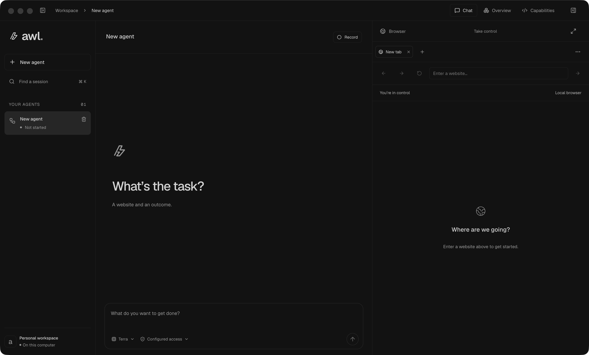
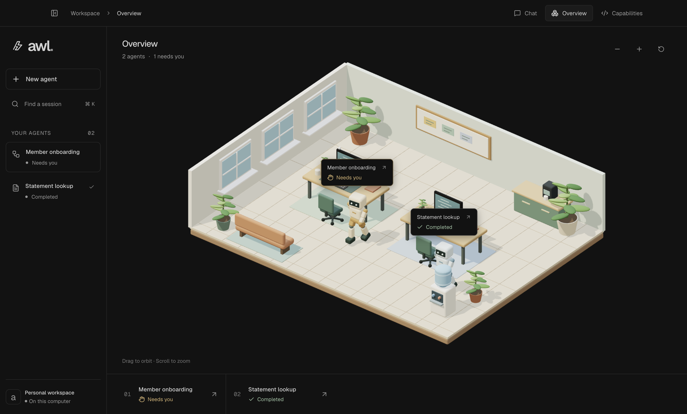

<h1> awl</h1>

**Computer use that learns a workflow, turns it into a capability, and asks for help when it needs you.**

Many back-office applications expose useful operations only through their interface. An AI agent can navigate those screens, but reasoning through every repeat adds cost, latency, and variability. awl uses a model for discovery and repair, then runs validated capabilities deterministically with new inputs.



*The local desktop workspace. Chat and automation share the same interactive browser with the human operator.*

[Design report](REPORT.md) · [Architecture](architecture.md) · [Capability schema](electron/tools/capability-write.cts) · [Policy example](policy.example.json) · [CI workflow](.github/workflows/checks.yml)

## Demo

**[Watch the demo — 4:09](docs/videos/awl-demo.mp4)**

[Saved artifact and run logs](evidence/README.md) · [Reproduce discovery and replay](evidence/REPRODUCE.md)

A real local walkthrough: discover a member lookup, save and validate a capability, replay it with new inputs, teach through recording, and ask for human help during repair. Includes the Overview and jumping from an agent into its chat.

Recorded with synthetic portal data and captions below the app. Sign-in is excluded; idle periods are shortened and accelerated footage is labeled.

<details>
<summary>Demo scope and known limitations</summary>

The discovery-authored capability passes validation with two input sets and replays without model calls. The separate recording-authored capability is shown as a draft. Repair demonstrates investigation and a human question, not a newly validated repair version.

Authentication pauses currently reset accumulated validation cases, so both sessions were authenticated before the final validation runs. The demonstrated balance output contains the full register text rather than an isolated currency value.

</details>

## Demo portal source

The fictional Member Servicing Portal used in the video is included in [`dummy/`](dummy/). It contains the application source, synthetic fixture definitions, dependency lockfile, and portal tests. It is a plain source copy, with no separate Git repository or recorded session data.

Requires **Python 3.12+** and **uv**. From the awl repository root, run it in a separate terminal:

```sh
cd dummy
uv sync --locked
uv run python run.py --port 7311
```

Open **http://127.0.0.1:7311** in awl's browser and allow that origin in **Manage access**. The first launch creates a fresh synthetic database; later launches preserve it. See the [portal README](dummy/README.md) for training logins and fresh-fixture setup, and [workflow scenarios](dummy/docs/scenarios.md) for inputs and expected outcomes.

## Run locally

Requires **Node.js 22.12+** and npm. Electron is installed with the project dependencies.

```sh
npm ci
npm run dev
```

Discovery and repair use a local **Codex CLI 0.155.0+** App Server. Install Codex and sign in with your ChatGPT account:

```sh
npm install -g @openai/codex
codex login
```

Optional settings in the project-root `.env`:

```dotenv
AWL_CODEX_MODEL=gpt-5.6-terra
# Set this if Electron cannot find your Codex installation.
# AWL_CODEX_BINARY=/absolute/path/to/codex
# Optional: use an independently authenticated Codex profile.
# AWL_CODEX_HOME=/absolute/path/to/codex-profile
# Optional: load access rules from a specific JSON file.
# AWL_POLICY_FILE=policy.example.json
```

Restart Electron after changing `.env`. awl uses Codex's existing login; it no longer reads `OPENAI_API_KEY` or calls the OpenAI SDK directly. For a separate profile, sign in using `CODEX_HOME=/absolute/path/to/codex-profile codex login`. Model selection is saved per chat; the Terra, Astra, Luna and custom choices must be available to that Codex account.

You can browse manually and run existing validated capabilities without Codex. Discovery, building a capability from a recording, and explicit repair require a working Codex login. The app and browser stay local; Codex sends model requests over the network. See the official [App Server documentation](https://developers.openai.com/codex/app-server/) and [authentication guide](https://developers.openai.com/codex/auth/).

**Codex branch:** the submission video and evidence below describe the earlier SDK build. They are not validation of this provider migration; a new live walkthrough is still needed.

| Command | Purpose |
| --- | --- |
| `npm run dev` | Start the desktop app with renderer hot reload. |
| `npm start` | Build and launch the desktop app. |
| `npm run dev:web` | Preview the React interface only; no native browser or agent runtime. |

Restart `npm run dev` after editing Electron or preload code. On macOS, the launcher prepares a cached awl.app with its own menu-bar and Dock identity.

## Configure access

Automation starts with **no permitted websites**. Open the composer's access dropdown → **Manage access** before starting a task.

1. Add the target origin and permitted paths, including any required frame or authentication destinations.
2. Choose allowed action types and narrowly scoped safe controls for buttons and Enter submissions.
3. Add application-specific blocked controls and private-field selectors, then select **Save access**.

Stop active agents and recordings before changing workspace policy. **Read only** restricts a chat to inspection, navigation, and scrolling within that policy. It does not grant additional access.

The [policy example](policy.example.json) demonstrates the file format; its localhost address and selectors must be adapted to your target. Origins are exact. Paths are exact or end in `/*` for a subtree. Rules persist in the local user-data directory, or in the file selected by `AWL_POLICY_FILE`.

Recognized consequential actions and explicitly blocked controls require direct human operation. A one-time handoff never becomes permanent permission. See [policy enforcement](electron/policy.cts) and [the access editor](src/components/PolicyEditor.tsx).

## Discover, validate, replay

Use a sandbox with synthetic data and a known starting state.

1. **Discover.** Select **New agent**, give a URL and a concrete goal, and let awl operate the live browser. State the expected result and where it should stop.
2. **Help when asked.** A structured question pauses automation. Complete the necessary action in the same browser, then select **Resume**. Authentication belongs in the browser, never in chat.
3. **Save.** Ask awl to save the successful workflow as a parameterized capability. Inspect its inputs, outputs, targets, exceptional states, and final checkpoint in **Capabilities**.
4. **Validate.** Supply input values and run validation. Parameterized capabilities need successful validation with two distinct input sets before **Run** becomes available. Each launch opens a new chat and browser session.
5. **Replay.** Select **Run** with new inputs. The executor follows the validated plan, checks completion, and returns outputs without model calls.
6. **Repair if needed.** An unexpected state pauses execution with context. **Repair with awl** explicitly reintroduces the model in the same browser and creates a separate draft. Validate the repaired version before using it again.

You can also teach by demonstration: select **Record**, perform the workflow, and select **Stop & build**. Recording continues across page changes. **Pause** excludes private interaction until you explicitly resume recording. The recorded steps remain available for review.

Capabilities compile into a constrained operation plan and a readable JavaScript artifact. The runtime executes the validated plan directly; it does not evaluate arbitrary generated JavaScript. Visual run-history playback only displays events and retained images—it never re-executes a capability.

## Workspace and overview

Sessions appear newest first. Both side panels collapse and resize. The composer includes model and access controls, and the chat navigation rail jumps between turns. Browser controls include fullscreen, detached preview, device sizing, DevTools, zoom, appearance, and cookie/cache management.

| Shortcut | Action |
| --- | --- |
| Cmd+B | Toggle the left sidebar. |
| Cmd+Option+B | Toggle the browser panel. |
| Cmd/Ctrl+L | Focus the browser address. |



*Overview with sample session states. Selecting an agent opens its conversation; changing views does not change execution state.*

The office projects session activity into working, waiting, and completed states. Completed agents head to the water cooler. It is optional; chat and browser remain the main workspace.

## Storage and privacy

State lives under Electron's user-data directory—on macOS, normally `~/Library/Application Support/awl/`:

| Location | Contents |
| --- | --- |
| `workspace/<chat-id>.json` | Redacted conversations, settings, reviewed recording state, and bounded run metadata. |
| `capabilities/<chat-id>/<capability-id>/` | Versioned contracts, generated JavaScript, and validation records. |
| `policy.json` | Workspace access rules, unless a custom policy file is configured. |

Workspace writes are atomic. awl's JSON files contain redacted conversation text, session state, and an optional `codexThreadId`; they omit raw tool history, screenshots, and execution values. Codex separately persists its own thread context under the selected Codex profile and manages compaction. Tool-result text is redacted before it reaches Codex; screenshots pass the existing privacy gate. Codex may retain those supplied observations, so its thread storage is also private session data.

awl resumes only the Codex thread referenced by its own session. It never imports unrelated Codex sessions. Existing SDK sessions start a new Codex thread from redacted text on their next message. Tabs and browser authentication are not restored. Deleting an awl session removes awl's data and mapping; it does not delete the corresponding Codex history. A missing Codex thread produces an error rather than silently replaying the task.

Private takeover stops model observation. Capture screens recognized authentication/payment fields and identified personal data, including supported frames and open shadow roots. Private values detected in a chat are redacted from its observations and saved text; capability writes reject known private literals. Detection is heuristic, so configure private-field selectors for your application and use synthetic data. Review evidence before publishing it.

Policy controls browser operations, not every possible side effect of the target's JavaScript. Stop prevents further scheduling; it cannot undo an action already dispatched. These boundaries are explained in [Architecture](architecture.md#policy-and-data-handling).

## Implementation map

| Area | Source |
| --- | --- |
| Design, boundaries, and trade-offs | [architecture.md](architecture.md) |
| Discovery, handoff, recording coordination, and repair | [agent-runtime.cts](electron/agent-runtime.cts) |
| Embedded browser and session lifecycle | [browser.cts](electron/browser.cts) |
| Model tools and their contracts | [tools/index.cts](electron/tools/index.cts), [tools/core.cts](electron/tools/core.cts) |
| Capability schema and versioned writes | [capability-write.cts](electron/tools/capability-write.cts) |
| Compilation, validation, and deterministic execution | [executor.cts](electron/executor.cts) |
| Target resolution and input bindings | [targeting.cts](electron/targeting.cts), [bindings.ts](shared/bindings.ts) |
| Structured execution results | [execution.ts](shared/execution.ts) |
| Policy and privacy | [policy.cts](electron/policy.cts), [privacy.cts](electron/privacy.cts) |
| Recording, evidence, and history | [recorder.cts](electron/recorder.cts), [evidence.cts](electron/evidence.cts), [journal.cts](electron/journal.cts) |
| Codex and local persistence | [codex-provider.cts](electron/codex-provider.cts), [agent-provider.cts](electron/agent-provider.cts), [workspace-store.cts](electron/workspace-store.cts) |

## Checks and current limits

[GitHub Actions](.github/workflows/checks.yml) builds the app and runs unit, browser, and workflow checks on Linux and macOS. Fixture checks use a fake Codex protocol peer and require neither a Codex login nor an API key; Linux uses Xvfb. Failure screenshots are uploaded as CI artifacts. The workflow runs `npm run build` followed by `npm run test:all`; `test:tools` and `test:ui` select smaller suites.

The current executor supports one tab and one declared origin per capability, seven operations, typed scalar inputs, and string extraction outputs. Targets can use CSS, common native roles and names, labels, placeholders, scoped text, frames, and open shadow roots. Missing or ambiguous targets pause execution.

Version 3 contracts distinguish business outcomes, bounded recovery, and hard failures. Recovery handles declared states; it never silently invokes a model or blindly repeats an uncertain write. Native desktop automation, tenant-specific capability packages, persistent login profiles, and downloads are not implemented. The demo above shows genuine discovery and replay against a local synthetic portal; the screenshots illustrate the interface. [Evidence](evidence/README.md) includes the saved artifact, run logs, failure capture, provenance, and reproduction instructions. The [design report](REPORT.md) explains the decisions, extension points, and remaining gaps. Final submission review remains outstanding.
