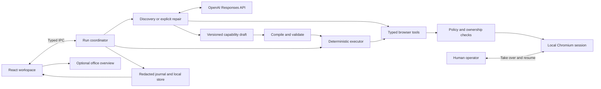

# awl architecture

awl is a local Electron application that turns a browser workflow into a reusable capability. This document describes the current implementation, its boundaries, and the extension points that remain design work.

## Execution loop

Discovery and repair use the OpenAI SDK to choose actions. Deterministic replay executes a validated capability plan without a model client. Both paths use the same browser adapter, policy checks, and ownership controls.

The compiler emits a readable JavaScript representation and a constrained operation plan. The runtime executes the validated plan directly. It does not evaluate the generated JavaScript or give artifacts arbitrary host execution privileges.

## Processes and boundaries

[main.cjs](electron/main.cjs) creates the desktop window, installs the browser manager, and initializes the agent runtime. [App.tsx](src/App.tsx) owns the React workspace. [preload.cjs](electron/preload.cjs) exposes a limited IPC bridge; [agent-ipc.cts](electron/agent-ipc.cts) authorizes requests from the workspace's main frame.

The Electron main process owns the model client, browser sessions, policy, capability execution, and local persistence. Target websites run in isolated browser contents with no application IPC or Node access. Chat displays the real browser surface through a `WebContentsView`; human interaction and automation operate the same page.

This is a single local application, without a separate server or execution worker. It keeps ownership and handoff coordination simple. Browser work is asynchronous, but heavier compilation or execution would need an isolated worker if it began blocking the main process. Model inference uses the network; local hosting does not imply offline discovery.

## Component map

| Component | Implementation | Responsibility |
| --- | --- | --- |
| Run coordinator | [agent-runtime.cts](electron/agent-runtime.cts) | Session state, model turns, cancellation, human questions, recording, validation, and repair transitions. |
| Browser manager | [browser.cts](electron/browser.cts) | Per-chat tabs, isolated browser sessions, native views, presentation, and lifecycle. |
| Tool boundary | [tools/core.cts](electron/tools/core.cts), [tools/index.cts](electron/tools/index.cts) | Strict argument validation, session-scoped execution, timeouts, and structured errors. |
| Target resolver | [targeting.cts](electron/targeting.cts) | Resolve an observed target in the correct frame and shadow scope; reject ambiguity. |
| Recorder | [recorder.cts](electron/recorder.cts) | Capture semantic human actions across page changes, with private gaps and bounded retention. |
| Capability writer | [capability-write.cts](electron/tools/capability-write.cts) | Validate contracts and save immutable, conflict-checked versions. |
| Compiler and executor | [executor.cts](electron/executor.cts) | Compile plans, bind inputs, validate runs, handle declared states, and verify outputs/checkpoints. |
| Policy | [policy.cts](electron/policy.cts), [policy-store.cts](electron/policy-store.cts) | Destination/action rules, safe and blocked controls, and revision-checked policy persistence. |
| Privacy and evidence | [privacy.cts](electron/privacy.cts), [evidence.cts](electron/evidence.cts) | Screen sensitive observations, redact identified values, and retain bounded failure structure. |
| Context and storage | [context.cts](electron/context.cts), [workspace-store.cts](electron/workspace-store.cts) | Context budgeting and atomic persistence of sanitized sessions. |
| History | [journal.cts](electron/journal.cts), [RunHistory.tsx](src/components/RunHistory.tsx) | Bounded events and visual playback, separate from execution. |
| Office | [Overview.tsx](src/components/overview/Overview.tsx) | Project actual session state into an optional 3D view. |

## Discovery and model context

The runtime uses the official OpenAI JavaScript SDK and Responses API. The default is `gpt-5.6-terra`; the environment and per-chat settings can select another supported model. The model receives strict tools for browser observation and action, chat naming, capability reading/writing, questions, completion, and evidence retrieval.

The runtime serializes tool calls and records their outcomes. A model response ending is not itself proof of task completion. Explicit completion and browser checkpoints determine the reported result. Each turn is bounded to 30 responses, 60 tool calls, and five minutes. Tool execution has a 20-second deadline, and repeated identical results prompt a human question.

Each chat has an in-memory SDK history containing messages, tool calls, and tool results. Requests use `store: false`. At the 48,000-token budget threshold, the context manager requests supported compaction and checks the resulting size. If compaction is unavailable or insufficient, execution stops with a context-limit error. Only the newest two screenshots remain in subsequent model requests.

Ownership, pending questions, capability versions, and run events live outside model context. Compaction cannot grant permissions or change execution state. Restart reconstructs model input from redacted conversation messages, rather than persisting opaque compaction data or raw tool observations.

## Browser targeting

The browser adapter uses Electron `webContents` and Chromium DevTools Protocol commands. [browser-dom.cts](electron/tools/browser-dom.cts) inspects supported frames and open shadow roots. Live actions consume snapshot-scoped references and reject stale or replaced elements before dispatch.

Reusable targets follow [target.ts](shared/target.ts): a CSS selector, role/name, label, placeholder, or scoped text; an optional frame identity; shadow-host selectors; and an optional container scope. The resolver requires a unique match. Radio and checkbox values are not used to generate reusable CSS selectors because those values may contain customer or account data.

[bindings.ts](shared/bindings.ts) substitutes declared inputs into target values, supported scopes, and assertions. CSS substitutions are escaped as values. Frame identities and roles remain literal. Reusable coordinates and model-assisted locator fallback are not part of deterministic replay.

This approach can inspect legacy layouts and nested frames, but it is still browser-specific. It does not guarantee access to closed shadow roots, canvas-only controls, or native desktop surfaces.

## Capability contract and execution

The [capability schema](electron/tools/capability-write.cts) is independent of the model transcript. A contract contains an ID, version metadata, one origin, typed inputs and outputs, ordered operations, target descriptions, a final text checkpoint, and optional exceptional-state handlers. Schema versions 1 and 2 remain readable; new drafts use version 3.

Supported operations are `navigate`, `click`, `fill`, `select`, `press`, `assert_text`, and `extract_text`. Inputs are strings, numbers, or booleans. Current extraction returns strings. The executor binds explicit values and checks targets and checkpoints through the browser adapter.

Versions are immutable. Writes require the expected previous version and reject conflicting updates. Validation records are tied to the artifact's content hash. Parameterized capabilities require successful validation with two distinct input sets before normal execution is enabled. This is a minimal generalization check, not a guarantee of reliability across all inputs.

Each run pins a capability version and receives a new chat/browser session. Its result follows [execution.ts](shared/execution.ts):

| Result | Meaning |
| --- | --- |
| `success` | The final checkpoint passed; declared outputs are returned. |
| `business_outcome` | A recognized business state, with its code, message, and step. |
| `failure` | A stopping condition with code, step, expectation, observation, and an uncertainty flag. |

Version 3 handlers can report an outcome, fail explicitly, or perform bounded recovery at a declared step. Recovery can wait or acknowledge a known control and then re-observe. It does not automatically repeat the previous action. Deterministic steps have a 15-second deadline; an unknown or ambiguous state pauses instead of invoking a model.

## Ownership, recording, and repair

Execution mode, controller, and capture state are separate. A session can be in discovery, deterministic execution, or repair while either the human or automation owns the browser. Capture may be private even while the human continues working.

1. A blocked condition, explicit takeover, or human interruption stops further automated scheduling.
2. Pending work is cancelled. An action already dispatched may have taken effect, so cancellation cannot claim to undo it.
3. The human receives the same live browser and a structured question with the stopping reason.
4. The human performs the necessary action and explicitly resumes. Authentication input stays private; a redacted explanation records other interventions.
5. The executor checks the relevant observable state before proceeding. Uncertain effects require confirmation and re-entry verification, rather than a blind retry.

Recording is explicit semantic action capture, not continuous video. Hooks are installed across document changes, with events delivered before navigation destroys the old document. Detected private frames are excluded without ending the recording session. Explicit Pause keeps capture off until the user resumes. Stop & build sends the reviewed demonstration into capability drafting. Unsupported targets and private intervals remain gaps for investigation.

Repair requires a separate user action. The runtime copies the pinned contract into the paused run's namespace, preserves the original capability, and lets the model investigate the same browser session. The result is a new draft requiring validation; a repair never silently replaces the version used by another run.

## Policy and data handling

Automation begins with no allowed destinations. [PolicyEditor.tsx](src/components/PolicyEditor.tsx) edits workspace rules; [policy.example.json](policy.example.json) shows the JSON structure. Configuration covers exact origins, path rules, action types, safe controls, blocked controls, and sensitive selectors. Per-chat read-only mode narrows the workspace policy.

Navigation, relevant popup/frame destinations, and automated actions pass through policy checks. Recognized consequential controls and explicit blocks require manual operation. A human intervention does not permanently broaden the allowlist. These rules restrict browser commands; they cannot prevent every side effect in JavaScript executed by an allowed website.

Private takeover stops model observation. Sensitive-page screening detects common password, OTP, and payment controls. Personal-data screening traverses supported frames and open shadow roots, including configured selectors and recognized name/contact fields and tables. Screenshot tools refuse capture when identified private content is visible.

Detected private values are retained in a per-chat registry for redaction and artifact checks. The registry has a 20,000-value limit; reaching it stops observation for that chat without disabling other chats. Successful session deletion releases its registry. Heuristic screening is incomplete: unstructured PII, unsupported surfaces, and misleading metadata can escape detection. Use synthetic data and application-specific rules, and review exported evidence.

Persistence uses local JSON files, not a database. Under Electron's user-data directory:

- `workspace/<chat-id>.json` stores sanitized conversations, settings, reviewed recording state, and bounded journal metadata. Writes use temporary files and atomic replacement.
- `capabilities/<chat-id>/<capability-id>/` stores versioned JSON contracts, generated JavaScript, and validation records.
- `policy.json` stores access rules unless an explicit policy path is configured.

Raw SDK history, opaque reasoning/compaction, screenshots, and execution input/output values remain in memory and are omitted from workspace files. Browser profiles and authentication are ephemeral. Restart restores conversations in private human control; it does not restore the browser or resume an interrupted capability.

## Evidence and UI projections

The journal retains at most 2,000 events, 20 exact tool results, and four permitted screenshots per session in memory. Failure capture adds bounded DOM structure and frame/control states while excluding text, values, URLs, and images from persisted failure evidence. This trades visual detail for safer durable diagnostics.

Run-history playback displays events and retained images; it never performs browser actions. The optional office view projects session status into working, waiting, stopped, and completed activity. Selecting an agent returns to its existing conversation. Session identity and browser lifetime are independent of which view is visible.

## Extension points and limits

The existing browser/tool boundary is a starting point for other surfaces, not a complete surface-neutral adapter. A native desktop adapter would need its own observation and action mechanisms, target representation, policy enforcement, and ownership semantics. The capability's typed inputs, outcomes, versioning, and checkpoint concepts could remain shared. Screenshot/coordinate targeting would need explicit anchors and verification rather than carrying raw coordinates across runs.

Multi-tenant reuse is design work. A future package could identify a vendor product and compatible versions, with separate tenant configuration for entry points, role mappings, and scoped target overrides. Each override should be versioned and validated against its tenant, while runtime compatibility checks pause unsupported variants. Shared workflows must not imply shared browser authentication or private-value registries.

Current limits include one tab and origin per capability, string extraction outputs, bounded recordings, heuristic privacy detection, and ephemeral browser sessions. Native desktop control, multi-tenant deployment, persistent login profiles, and downloads are not implemented. [GitHub CI](.github/workflows/checks.yml) checks the browser implementation on Linux and macOS using synthetic fixtures; genuine target discovery and replay evidence must be collected separately.
